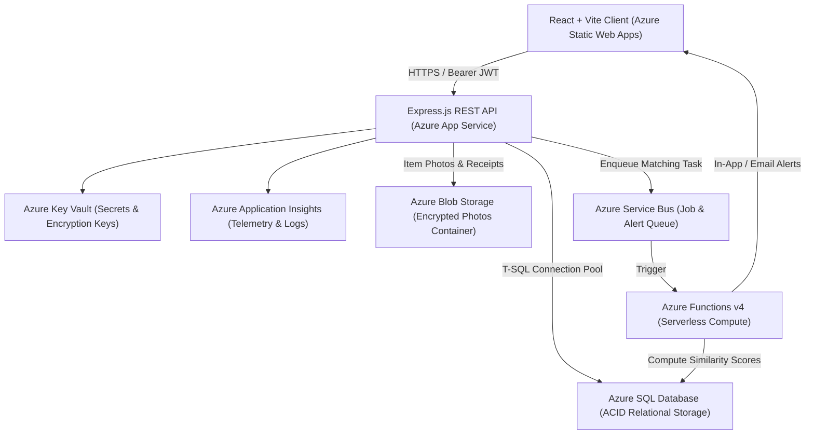
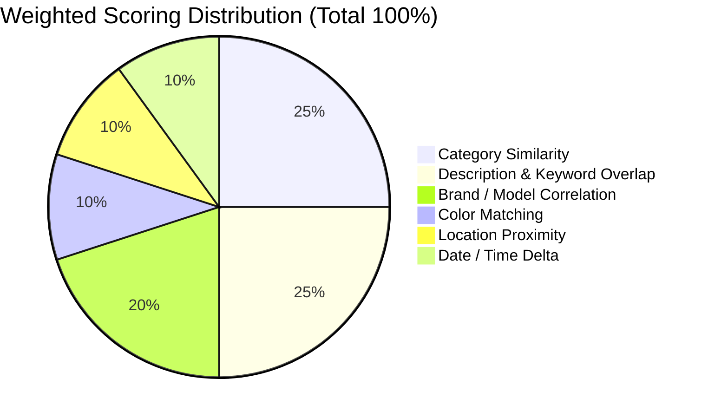

# CampusTrace: System Architecture & Cloud Topology

## 1. Cloud-Native Architectural Topology

CampusTrace implements an enterprise 3-tier decoupled cloud architecture deployed across Microsoft Azure services:

---

## 2. Component Role Breakdown

| Component | Cloud Service | Purpose & Scaling Profile |
| :--- | :--- | :--- |
| **Frontend Web App** | Azure Static Web Apps | Single-Page Application (SPA) with global edge distribution |
| **Application Tier** | Azure App Service (Linux) | RESTful API engine with auto-scaling (1–4 instances) |
| **Database** | Azure SQL Database | Serverless relational engine for persistent ACID data |
| **Object Store** | Azure Blob Storage | Secure, tokenized photo and receipt proof storage |
| **Async Processor** | Azure Functions v4 | Serverless background matching engine & notification worker |
| **Message Broker** | Azure Service Bus | Decouples report ingestion from algorithmic evaluation |
| **Observability** | Azure Application Insights | Distributed trace latency, request rates, and telemetry |

---

## 3. Intelligent Weighted Matching Engine

When an item report is submitted, candidate records of the opposite report type (`LOST` vs. `FOUND`) in an open state are evaluated against a configurable scoring model:

$$ \text{Total Score} = w_{\text{cat}} \cdot S_{\text{cat}} + w_{\text{desc}} \cdot S_{\text{desc}} + w_{\text{brand}} \cdot S_{\text{brand}} + w_{\text{col}} \cdot S_{\text{col}} + w_{\text{loc}} \cdot S_{\text{loc}} + w_{\text{date}} \cdot S_{\text{date}} $$

- **Threshold**: Pairs scoring $\ge 50\%$ trigger automatic correlation match records and emit notification alerts to both reporters.
- **Verification Rule**: A high match confidence score does not prove ownership. Mandatory private identifying verification is enforced before handover.