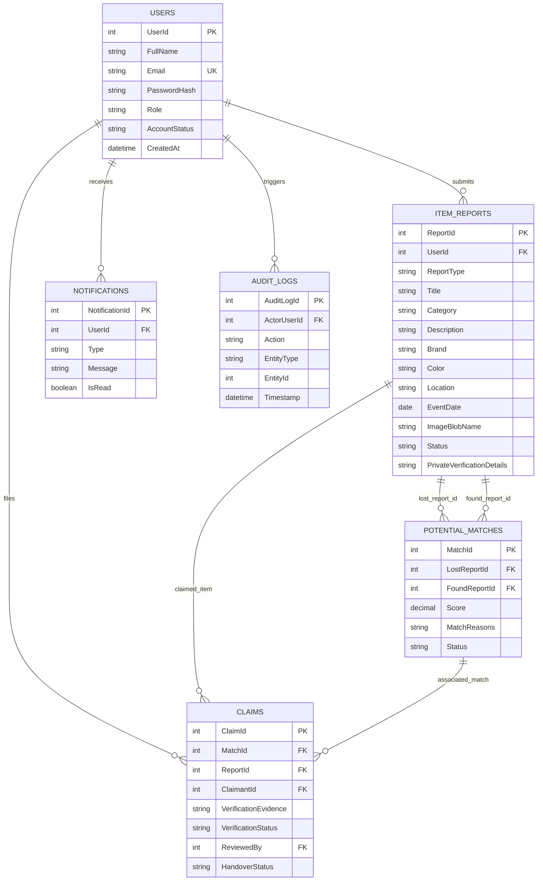

# CampusTrace: Database Design & Entity Relationship Specifications

## 1. Entity-Relationship Diagram (ERD)

The relational schema is implemented in 3NF on **Azure SQL Database**:

---

## 2. Table Catalog & Constraint Enforcements

- **Users**: Normalized email constraint (`UQ_Users_Email`), role guard check (`CK_Users_Role` for student, faculty, admin).
- **ItemReports**: Disallows arbitrary report types (`CK_ItemReports_ReportType`), tracks status (`OPEN`, `MATCHED`, `CLAIMED`, `RESOLVED`, `EXPIRED`).
- **PotentialMatches**: Prevents duplicate pairs via unique constraint (`UQ_PotentialMatches_Pair`), bounds score between 0.0 and 100.0 (`CK_PotentialMatches_Score`).
- **Claims**: Two-tier verification (`VerificationStatus`: PENDING, APPROVED, REJECTED; `HandoverStatus`: PENDING, CONFIRMED).
- **Notifications**: Indexed by `UserId` and `IsRead` for zero-latency in-app bell counters.
- **AuditLogs**: Immutable operational tracking for compliance and dispute mediation.